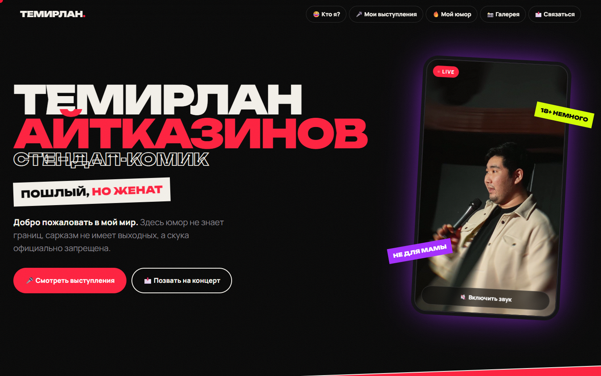
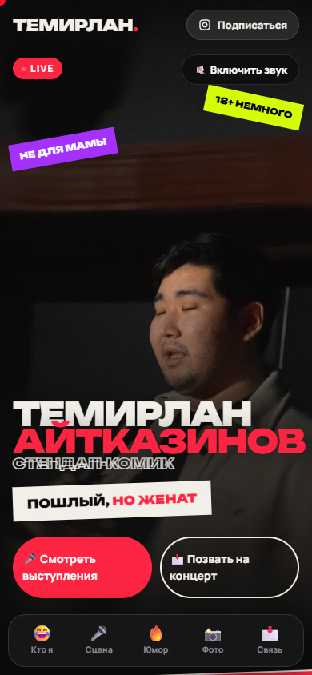

# Сайт-визитка стендап-комика

Промо-сайт для стендап-комика Темирлана Айтказинова: чёрный фон, кислотные акценты, дерзкая типографика и интерактив с характером.

**🔗 Живой сайт: [timkakomik.github.io](https://timkakomik.github.io)**

<p>
  
  
</p>

## Задача

Сделать яркий сайт-визитку, который передаёт стиль артиста, собирает его выступления и соцсети в одном месте и при этом ничего не стоит в поддержке.

## Что внутри

- **Первый экран:** вертикальное промо-видео в автоплее. На телефоне оно на весь экран, как в TikTok, с переключателем звука.
- **Глитч-заголовок,** бегущие строки, «стикеры», плёночное зерно и кастомный курсор.
- **Интерактив:**
  - «Шкала пошлости» — ползунок с меняющимися подписями;
  - кнопка «НЕ НАЖИМАТЬ» с вибро-откликом на Android;
  - «Серьёзный режим», который на секунду превращает сайт в скучный.
- **Выступления:** YouTube-плеер в lite-режиме, iframe грузится только по клику.
- **Галерея** с лайтбоксом. На телефоне листается свайпом, как сторис, с индикатором-точками.
- **Мобильная версия как приложение:** нижний таб-бар с подсветкой текущего раздела.
- **Возраст считается автоматически** от даты рождения, со склонением «год / года / лет». В день рождения на сайте появляется поздравление.
- Анимации появления при скролле, поддержка `prefers-reduced-motion`.

## Стек

- Чистые **HTML, CSS и JavaScript**: без фреймворков и сборки, один файл.
- Шрифты Google Fonts: Unbounded и Manrope.
- **Оптимизация медиа:** видео перекодировано из HEVC в H.264 (45 МБ → 6 МБ) для совместимости со всеми браузерами, фото сжаты.
- **Хостинг:** GitHub Pages, бесплатно.

## Запуск локально

```bash
python -m http.server 8000
```

Затем открыть http://localhost:8000

## Структура

```
index.html      — вся разметка, стили и скрипты
reel.mp4/.jpg   — промо-видео и его превью
*.jpg           — фотографии
screenshots/    — скриншоты для README
```
